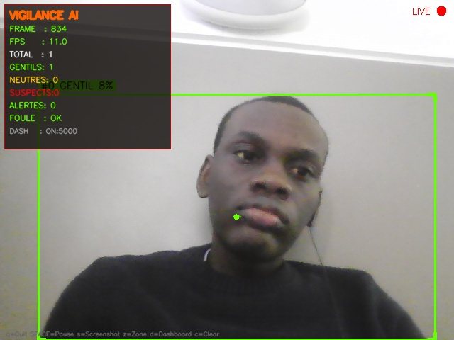

# VIGILANCE IA

<strong>Analyse vidéo assistée par intelligence artificielle</strong> 
Détection d'objets · Suivi visuel · Vision par ordinateur

<a href="https://github.com/INFOTELCOM/VIGILANCE-IA">Dépôt GitHub</a> ·
<a href="https://github.com/INFOTELCOM/VIGILANCE-IA/issues">Signaler un problème</a>

VIGILANCE IA est un projet expérimental de vision par ordinateur développé en **Python**. Il s'appuie principalement sur **YOLOv8** et **OpenCV** pour analyser des vidéos, détecter des personnes et certains objets, suivre des déplacements et produire des annotations visuelles.

Deux interfaces sont proposées :
- **detector.py** : pipeline local pour webcam, fichiers vidéo et flux caméra, avec affichage OpenCV et fonctions de suivi / journalisation.
- **app.py** : interface web **Gradio** pour téléverser une vidéo, régler les paramètres d'analyse et récupérer une vidéo annotée accompagnée d'un rapport.

> **Nature du projet : prototype expérimental.** Les scores et catégories affichés reposent sur des heuristiques simples. Ils ne déterminent pas l'intention d'une personne, ne prouvent aucune infraction et ne doivent jamais servir seuls à prendre une décision concernant un individu. Toute interprétation doit rester sous contrôle humain.

## Aperçu

*Capture du projet. Les résultats varient selon la vidéo, le matériel et les paramètres.*

## Fonctionnalités

### Détection et suivi
- Détection de personnes par YOLOv8.
- Détection de certaines catégories d'objets et de véhicules.
- Suivi visuel entre les images et affichage des trajectoires.
- Annotations avec identifiants, boîtes de détection et indicateurs.

### Analyse expérimentale
- Estimation de mouvements simples (marche, course, déplacement rapide).
- Calcul d'un score heuristique et catégorisation indicative par seuils.
- Indicateurs de densité de foule et alertes de zone dans le pipeline local.

### Interfaces et données
- Interface locale OpenCV.
- Interface web Gradio pour analyser des fichiers vidéo.
- Fonctions Flask et journalisation dans le pipeline local.
- Exports JSON / GeoJSON selon les fonctions utilisées.

### Module GPS expérimental
Le module **gps_engine.py** propose des fonctions de projection image-vers-coordonnées, de géocodage inverse et d'export GeoJSON. Il peut interroger ipinfo.io, OpenStreetMap Nominatim, OpenCage et What3Words.

**Limite importante :** une position issue d'une adresse IP est approximative. La projection de pixels vers le sol dépend de la calibration, de la géométrie et de la position réelle de la caméra. Il ne s'agit pas d'une mesure GPS directe des personnes et ces résultats doivent être validés indépendamment.

## Architecture

~~~text
VIGILANCE-IA/
├── app.py                  # Interface Gradio d'analyse vidéo
├── detector.py             # Pipeline local de détection et suivi
├── gps_engine.py           # Fonctions expérimentales de géolocalisation
├── yolov8n.pt              # Poids du modèle YOLOv8 nano
├── requirements.txt        # Dépendances Gradio / environnement headless
├── requirements_local.txt  # Dépendances de l'application locale
├── .env.example            # Exemple de configuration des clés API
├── README.md               # Documentation principale
├── README_HF.md            # Métadonnées Hugging Face Spaces
└── screenshot_834.jpg      # Capture d'écran
~~~

## Technologies

| Technologie | Utilisation |
|---|---|
| Python | Langage principal |
| YOLOv8 / Ultralytics | Détection d'objets |
| OpenCV | Traitement et affichage vidéo |
| NumPy | Calculs numériques |
| Gradio | Interface web |
| Flask | Services / dashboard du pipeline local |
| DeepFace | Dépendance du pipeline local |
| Requests | Requêtes vers les services externes |

## Prérequis

- **Python 3.10 ou 3.11** recommandé.
- Git.
- Webcam, fichier vidéo ou flux caméra pour les tests locaux.
- Connexion Internet pour installer les dépendances et accéder aux services externes.
- Windows, Linux ou macOS. Un GPU compatible CUDA peut accélérer l'inférence, mais les performances dépendent du matériel et de la résolution.

Aucun débit d'images par seconde n'est garanti.

## Installation

### 1. Cloner le dépôt

~~~bash
git clone https://github.com/INFOTELCOM/VIGILANCE-IA.git
cd VIGILANCE-IA
~~~

### 2. Créer un environnement virtuel

**Windows — PowerShell**

~~~powershell
py -3.11 -m venv venv
.\venv\Scripts\Activate.ps1
~~~

Si l'activation est bloquée par la politique PowerShell, et si cela est autorisé sur votre poste :

~~~powershell
Set-ExecutionPolicy -Scope Process -ExecutionPolicy Bypass
.\venv\Scripts\Activate.ps1
~~~

**Linux / macOS**

~~~bash
python3.11 -m venv venv
source venv/bin/activate
~~~

### 3. Installer les dépendances

Pour l'application locale avec affichage OpenCV :

~~~bash
python -m pip install --upgrade pip
pip install -r requirements_local.txt
~~~

Pour l'interface Gradio en environnement sans affichage :

~~~bash
pip install -r requirements.txt
~~~

Les deux fichiers de dépendances utilisent des variantes OpenCV différentes. Il est préférable de choisir le fichier adapté à l'usage plutôt que d'installer les deux dans le même environnement.

## Démarrage

### Interface Gradio

~~~bash
python app.py
~~~

Ouvrez l'adresse locale indiquée dans le terminal (généralement **http://127.0.0.1:7860**), importez une vidéo, ajustez les paramètres puis lancez l'analyse.

### Pipeline local

~~~bash
python detector.py
~~~

Pour connaître les options disponibles dans la version du dépôt :

~~~bash
python detector.py --help
~~~

### Tester le module GPS séparément

~~~bash
python gps_engine.py
~~~

Ce test peut effectuer des requêtes vers des services Internet tiers. Leur disponibilité et leurs quotas peuvent évoluer.

## Configuration GPS facultative

Copiez le fichier d'exemple :

**Windows PowerShell**
~~~powershell
Copy-Item .env.example .env
~~~

**Linux / macOS**
~~~bash
cp .env.example .env
~~~

Renseignez les clés nécessaires dans le fichier **.env** :

~~~dotenv
OPENCAGE_KEY=votre_cle_opencage
W3W_KEY=votre_cle_what3words
~~~

Consultez les sites officiels pour connaître les conditions et quotas en vigueur. **Ne publiez jamais votre fichier .env ni vos clés API.**

## Utilisation responsable et confidentialité

Le traitement vidéo peut concerner des personnes identifiables. Avant tout test ou déploiement :
- utilisez uniquement des vidéos pour lesquelles vous disposez des autorisations nécessaires ;
- informez les personnes concernées lorsque la réglementation l'exige ;
- limitez la collecte, les accès, la conservation et le partage des images ;
- sécurisez les fichiers, journaux et interfaces réseau ;
- vérifiez les résultats manuellement et documentez les erreurs et biais possibles ;
- ne prenez aucune décision concernant une personne sur la seule base d'un score ou d'une catégorie générés.

Le projet ne doit pas être utilisé pour profiler, discriminer, sanctionner ou surveiller illégalement des personnes. Tout déploiement réel nécessite une analyse juridique, technique et éthique préalable, notamment au regard du RGPD et des règles applicables à la vidéosurveillance.

## Limites connues

- La qualité des détections dépend de l'éclairage, de l'angle de caméra, de la résolution et des occultations.
- Le suivi peut perdre ou réattribuer un identifiant lorsque des personnes se croisent ou sortent du champ.
- Les scores de comportement sont des règles expérimentales, non des modèles validés scientifiquement.
- La détection d'un objet ne révèle ni son contexte ni l'intention de la personne qui le transporte.
- La géolocalisation par IP ou projection de pixels est indicative et nécessite une calibration et une validation indépendantes.
- Ce prototype n'est pas un système certifié de sécurité ou de surveillance.

## Contribuer

Les contributions sont les bienvenues : corrections, documentation, tests, amélioration de la robustesse et signalement de bugs.

1. Forkez le dépôt.
2. Créez une branche de travail.
3. Effectuez vos changements et testez-les.
4. Ouvrez une Pull Request en décrivant le problème et la solution.

Pour signaler un bug, utilisez [GitHub Issues](https://github.com/INFOTELCOM/VIGILANCE-IA/issues). Indiquez votre système, votre version de Python, les étapes de reproduction et les journaux pertinents, sans données personnelles ni clés API.

## Auteur

**VIGILANCE IA** — projet développé par **Mayele**, au sein de l'écosystème **INFOTELCOM**.

- Organisation : [INFOTELCOM](https://github.com/INFOTELCOM)
- Dépôt : [INFOTELCOM/VIGILANCE-IA](https://github.com/INFOTELCOM/VIGILANCE-IA)

---

Python · YOLOv8 · OpenCV · Vision par ordinateur

